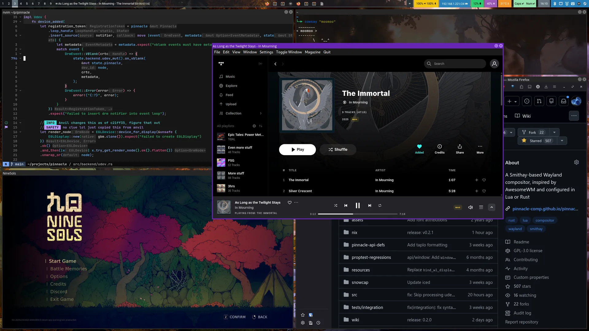

## About
Pinnacle is a Wayland compositor built in Rust using [Smithay](https://github.com/Smithay/smithay).
It's my attempt at creating something like [AwesomeWM](https://github.com/awesomeWM/awesome)
for Wayland.

This repository is a fork of [pinnacle-comp/pinnacle](https://github.com/pinnacle-comp/pinnacle),
which has had no upstream activity since 2026-06-27. The fork adds HDR output
support and the fixes needed to run Pinnacle as a daily driver.

## Features
- Tag system
- Dynamic tiling
- Customizable layouts
- Support for most wlr protocols
- Floating window support
- Xwayland support
- Configurable in Lua or Rust
- HDR output (fork)
- Is very cool 👍

## Getting started, building, and running

Read the [upstream wiki](https://pinnacle-comp.github.io/pinnacle/getting-started/introduction.html)
to get started. It documents the compositor as of the last upstream release and
mostly still applies.

## Roadmap

See [`TODO.md`](TODO.md). The upstream roadmap issue
([#403](https://github.com/pinnacle-comp/pinnacle/issues/403)) is dormant.

## API references
<b>Lua: https://pinnacle-comp.github.io/lua-reference 
Rust: https://pinnacle-comp.github.io/rust-reference/main</b>

These are built from the last upstream release and do not cover the fork's
additions.

## Contributing

This is a personal fork and has no contribution process. It exists so that one
machine keeps a working compositor; it is not a community project.

## Special Thanks
- [Smithay](https://github.com/Smithay/smithay): For being a great compositor library and also allowing me not to deal with all the graphics stuff I still don't understand
- [Niri](https://github.com/YaLTeR/niri): For all that rendering and protocol stuff I, ahem, *took inspiration* from. And session stuff. And the test fixture.
